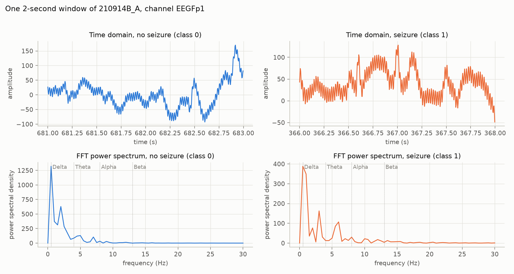
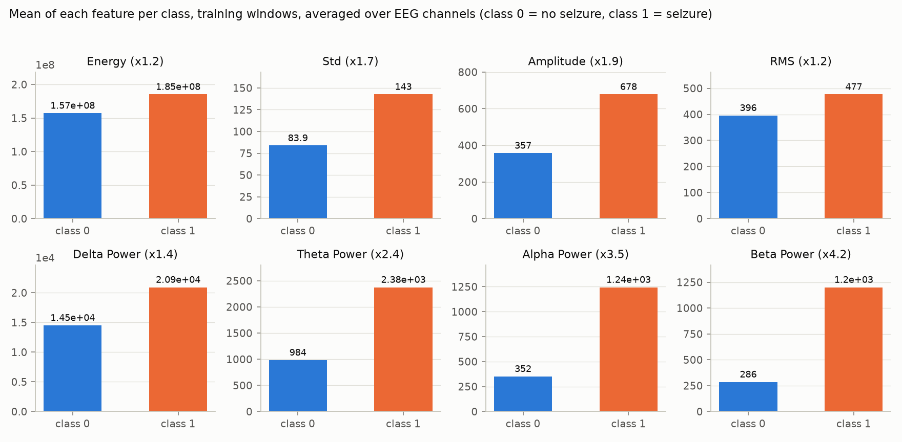
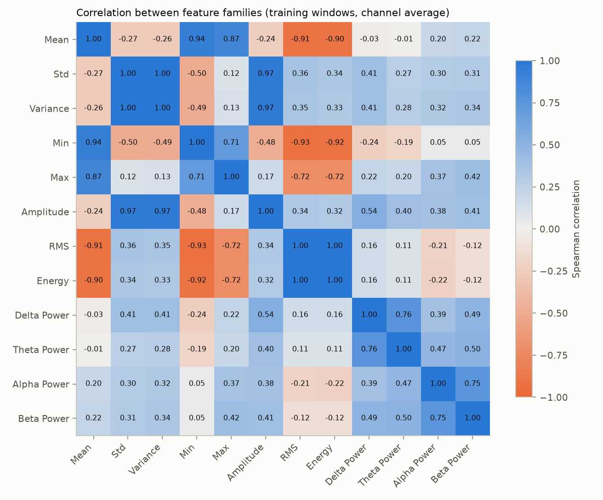
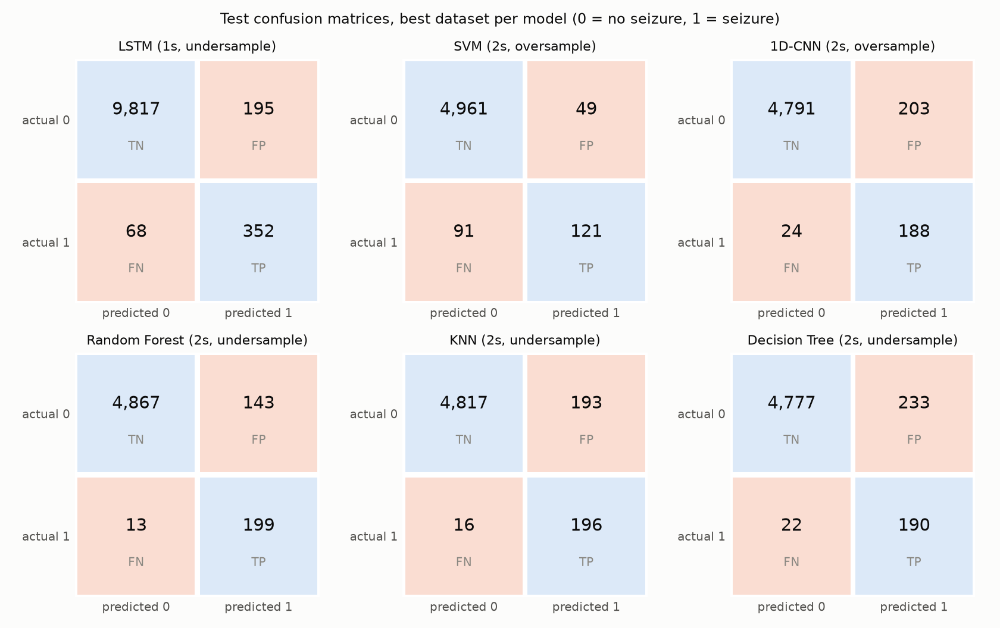
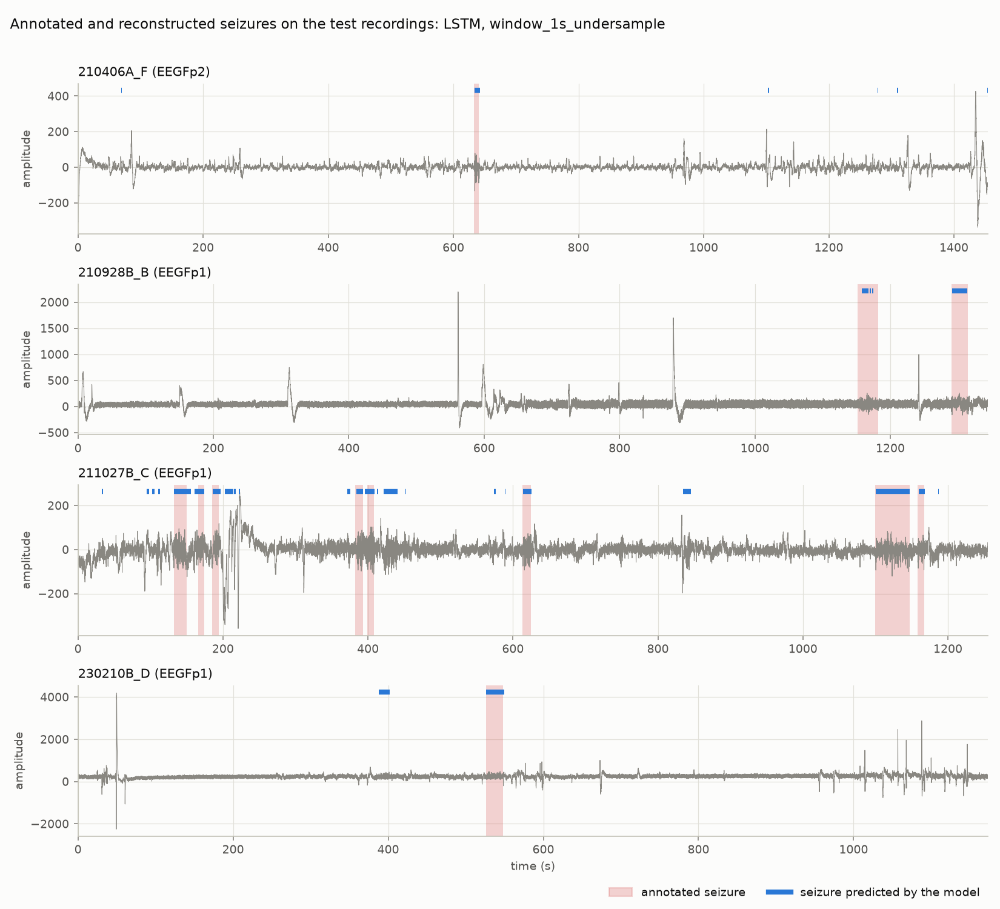

# Automatic detection of absence seizures from EEG: answers to Questions 9 to 14

This report answers Questions 9 to 14 of the mini-project, followed by the
error analysis (Part XI) and the proposed improvements (Part XII). Questions 1
to 8 are answered interactively in the Streamlit application. Every number
below was produced by the scripts in `scripts/` and can be regenerated with
the commands in the project README.

## Summary

- Adding the four frequency-band powers was the most useful single step: used
  alone, each band separates seizure from non-seizure windows better than any
  temporal feature.
- The model selected on validation data is an **LSTM on 1-second windows with
  an undersampled training set**. On the four held-out test recordings it
  reaches a seizure recall of 0.84, a precision of 0.64, and an F1 of 0.73.
- After merging predicted windows into intervals, the model **detects all 12
  test seizures**, with a mean onset error of 0.4 s. It also raises 21 false
  alarms in 1.45 hours of recording; 15 of them are in one recording.
- Accuracy is 0.95 to 0.98 for every model and tells them apart poorly; recall,
  precision, and F1 on the seizure class are the metrics used.
- The test set holds only 12 seizures from 4 recordings. Cross-validation
  shows that scores vary strongly from one group of recordings to another, so
  the ranking of models is indicative, not established. The Random Forest
  (test F1 0.72) is nearly as good as the LSTM and the most stable classical
  model.

## Data and method in brief

| Item | Value |
|---|---|
| Recordings used | 18 of 22, with 71 annotated seizures (3 to 49 s, median 11 s) |
| Labels | `Annotations.xlsx` only; the `h` annotation files carry no usable times |
| Excluded | `200625A_F`, `210204B_C`, `210208B_G` (absent from the workbook) and `210504B_C` (first seizure entered with an impossible end time) |
| Windows | 1 s and 2 s, 50% overlap; class 1 when at least 50% of samples are in a seizure |
| Dataset, 1 s | 51,766 windows: 49,800 class 0 and 1,966 class 1 (3.8%) |
| Dataset, 2 s | 25,874 windows: 24,873 class 0 and 1,001 class 1 (3.9%) |
| Columns | 5 identifiers, 228 features, 1 label; no missing value, no duplicated window |

**Split.** Windows overlap by 50%, so neighbouring windows share half their
samples. A random 80/20 split of windows, as the assignment suggests, would
put near-copies of training windows in the test set and inflate every score.
The split is therefore made on whole recordings and stratified on the seizure
rate: about 20% of recordings are held out for the test, and the rest is
divided into train and validation so that the test set is used once.

| Partition | Recordings | 1 s windows | Seizure windows | Seizures |
|---|---:|---:|---:|---:|
| Train | 11 | 32,819 | 1,162 (3.5%) | 46 |
| Validation | 3 | 8,499 | 384 (4.5%) | 13 |
| Test | 4 | 10,448 | 420 (4.0%) | 12 |

The test recordings are `210406A_F`, `210928B_B`, `211027B_C`, and
`230210B_D`. The split was chosen from labels and group sizes only, with a
fixed seed, never from model performance.

**Class imbalance.** Only the training rows are balanced, in three ways:
undersampling the majority class to the minority count, oversampling the
minority class to the majority count, and a hybrid that brings both to the
midpoint. With two window durations this gives six training sets. Validation
and test data keep their real 4% seizure rate.

**Leakage controls.** Imputation and scaling are fitted on training rows.
Identifiers and times are never features. Hyperparameters and the decision
threshold are chosen on validation data.

## Question 9: power in the frequency bands

For each window and each EEG channel, the signal is mean-centred and its FFT
gives a one-sided power spectral density, `2 |X(f)|² / (fs · N)`. The power of
a band is the integral of that density between the band limits:

| Band | Frequencies |
|---|---|
| Delta | 0.5–4 Hz |
| Theta | 4–8 Hz |
| Alpha | 8–13 Hz |
| Beta | 13–30 Hz |

This adds 4 features per channel to the 8 temporal ones, 76 new columns for
19 EEG channels. The computation is checked by a unit test: a unit sine at 3,
6, 10, or 20 Hz has all of its power, 0.5, in its own band.

The seizure window shows peaks near 3 Hz and 6 Hz, the expected signature of
the 3 Hz spike-and-wave discharge of absence seizures and its first harmonic.
The non-seizure window has its power below 3 Hz, typical of slow drift.

## Question 10: comparing the features between the two classes

Features are averaged over the EEG channels of each window, on training
windows only (15,811 class 0 and 593 class 1, 2-second windows).

| Feature | Mean, class 0 | Mean, class 1 | Ratio | Std, class 0 | Std, class 1 | AUC alone |
|---|---:|---:|---:|---:|---:|---:|
| Energy | 1.57e8 | 1.85e8 | 1.2 | 1.98e8 | 1.38e8 | 0.59 |
| Std | 83.9 | 142.6 | 1.7 | 112.1 | 94.0 | 0.83 |
| Amplitude | 357 | 678 | 1.9 | 477 | 387 | 0.89 |
| Delta power | 14,516 | 20,921 | 1.4 | 165,470 | 113,891 | 0.92 |
| Theta power | 984 | 2,376 | 2.4 | 10,039 | 2,591 | 0.95 |
| Alpha power | 352 | 1,245 | 3.5 | 3,699 | 1,234 | 0.94 |
| Beta power | 286 | 1,201 | 4.2 | 3,478 | 1,684 | 0.95 |

"AUC alone" is the area under the ROC curve when the feature is used by itself
as a seizure score; 0.5 means no information.

- Seizure windows have more power in every band, 1.4 to 4.2 times more on
  average.
- Amplitude and standard deviation roughly double during seizures.
- Energy and RMS barely change (ratio 1.2). The signals have a large constant
  offset (mean about −280), and the sum of squares is dominated by that
  offset, not by the oscillation.
- Standard deviations are large compared with the means, because artefacts
  give a few windows extreme values. The classes overlap, so no single
  threshold on one feature is enough.

## Question 11: correlation between features

**Strongly correlated features.**

| Pair | Spearman correlation |
|---|---:|
| RMS and Energy | 1.00 |
| Std and Variance | 1.00 |
| Std (or Variance) and Amplitude | 0.97 |
| Mean and Min | 0.94 |
| Min and RMS | −0.93 |
| Mean and RMS | −0.91 |
| Delta and Theta power | 0.76 |
| Alpha and Beta power | 0.75 |

**Redundant information.** Yes. Variance is the square of Std, and Energy is
the square of RMS times the window length, so each pair carries exactly the
same ranking. Mean, Min, RMS, and Energy all follow the signal offset. The 12
features per channel reduce to roughly four groups: offset (Mean, Min, Max,
RMS, Energy), spread (Std, Variance, Amplitude), slow activity (Delta, Theta),
and fast activity (Alpha, Beta). The features were all kept: tree models are
insensitive to redundancy, and KNN and SVM are the ones it can hurt.

**Most discriminant features.** The band powers: Beta (AUC 0.95), Theta
(0.95), Alpha (0.94), and Delta (0.92), followed by Amplitude (0.89), Variance
and Std (0.83). Mean, Max, RMS, and Energy are close to uninformative (0.57 to
0.60).

## Question 12: models and evaluation

Four classical models were trained on each of the six training sets, with a
small hyperparameter grid evaluated on the validation recordings. Two sequence
models, a 1D-CNN and an LSTM, were added as the deep-learning improvement.

| Model | Settings searched or used |
|---|---|
| Decision Tree | `max_depth` 5, 10, unlimited; `min_samples_leaf` 5, 20 |
| Random Forest | 300 trees; `max_depth` 12, unlimited; `min_samples_leaf` 1, 5 |
| KNN | standardized features; 5, 11, 21 neighbours; uniform or distance weights |
| SVM | standardized features; RBF kernel; `C` 0.1, 1, 10 |
| 1D-CNN | 5 consecutive windows; two convolution layers (32 and 16 filters), global average pooling |
| LSTM | 5 consecutive windows; one layer of 32 units, dropout 0.2 |

For each model, the decision threshold on its seizure score is the one that
maximizes F1 on validation data. The neural networks are trained with Adam and
stopped when validation F1 has not improved for five epochs. For the CNN and
LSTM, sequences are built from consecutive windows of one recording and the
training sequences are balanced afterwards, because resampled rows are no
longer consecutive.

### Test results, best training set per model

The training set of each model is the one with the best validation F1.

| Model | Training set | Validation F1 | Accuracy | Precision | Recall | F1 | PR-AUC |
|---|---|---:|---:|---:|---:|---:|---:|
| Decision Tree | 2 s, undersample | 0.765 | 0.951 | 0.449 | 0.896 | 0.598 | 0.419 |
| Random Forest | 2 s, undersample | 0.797 | 0.970 | 0.582 | 0.939 | 0.718 | 0.732 |
| KNN | 2 s, undersample | 0.782 | 0.960 | 0.504 | 0.925 | 0.652 | 0.493 |
| SVM | 2 s, oversample | 0.830 | 0.973 | 0.712 | 0.571 | 0.634 | 0.630 |
| 1D-CNN | 2 s, oversample | 0.822 | 0.956 | 0.481 | 0.887 | 0.624 | 0.606 |
| **LSTM** | 1 s, undersample | **0.836** | 0.975 | 0.644 | 0.838 | **0.728** | 0.719 |

Precision, recall, and F1 are for the seizure class. The complete table of 36
runs is in `results/model_comparison.csv`.

### Confusion matrices

| Model | TN | FP | FN | TP |
|---|---:|---:|---:|---:|
| Decision Tree | 4,777 | 233 | 22 | 190 |
| Random Forest | 4,867 | 143 | 13 | 199 |
| KNN | 4,817 | 193 | 16 | 196 |
| SVM | 4,961 | 49 | 91 | 121 |
| 1D-CNN | 4,791 | 203 | 24 | 188 |
| LSTM (1 s windows) | 9,817 | 195 | 68 | 352 |

Reading the matrices: the Random Forest misses the fewest seizure windows (13
of 212) at the cost of 143 false alarms. The SVM is the opposite: only 49
false alarms, but it misses 91 seizure windows, 43% of them. The LSTM counts
are on 1-second windows, so there are about twice as many windows.

### Effect of the training set

Test F1 for every model and training set:

| Model | 1 s hybrid | 1 s over | 1 s under | 2 s hybrid | 2 s over | 2 s under |
|---|---:|---:|---:|---:|---:|---:|
| Decision Tree | 0.664 | 0.696 | 0.299 | 0.540 | 0.540 | 0.598 |
| Random Forest | 0.660 | 0.635 | 0.689 | 0.682 | 0.664 | 0.718 |
| KNN | 0.294 | 0.537 | 0.442 | 0.373 | 0.333 | 0.652 |
| SVM | 0.524 | 0.663 | 0.696 | 0.587 | 0.634 | 0.565 |
| 1D-CNN | 0.625 | 0.675 | 0.687 | 0.634 | 0.624 | 0.485 |
| LSTM | 0.715 | 0.722 | 0.728 | 0.689 | 0.617 | 0.638 |

- The Random Forest and the LSTM are the most stable: their F1 stays between
  0.62 and 0.73 whatever the training set.
- The Decision Tree and KNN are unstable, from 0.29 to 0.70. A single tree
  overfits, and KNN suffers from 228 correlated features.
- No balancing method or window duration wins for every model. Undersampling
  keeps only 1,162 or 593 windows per class and still gives the best test F1
  for five of the six models, so the amount of non-seizure data is not the
  limiting factor.

### How reliable is the ranking?

The validation and test sets hold 13 and 12 seizures, so one split is a thin
basis for ranking models. As a check, the four classical models were
re-evaluated with a grouped 5-fold cross-validation on the 14 development
recordings (59 seizures), with their selected training set and
hyperparameters. In each round, three folds are balanced and used for fitting,
one fold sets the threshold, and one is held out. Test recordings are not
used.

| Model | F1, mean ± std | Recall, mean ± std | Precision, mean ± std | PR-AUC, mean ± std |
|---|---:|---:|---:|---:|
| Random Forest | 0.61 ± 0.08 | 0.60 ± 0.20 | 0.71 ± 0.17 | 0.71 ± 0.04 |
| KNN | 0.54 ± 0.10 | 0.58 ± 0.21 | 0.61 ± 0.23 | 0.54 ± 0.07 |
| Decision Tree | 0.39 ± 0.22 | 0.56 ± 0.23 | 0.41 ± 0.25 | 0.34 ± 0.20 |
| SVM | 0.30 ± 0.24 | 0.66 ± 0.37 | 0.21 ± 0.18 | 0.57 ± 0.19 |

- The **Random Forest** is the most robust classical model: best mean F1,
  smallest spread, and a PR-AUC that barely moves between folds.
- The **SVM** does not confirm its second place on validation. Its F1 falls to
  0.00 and 0.08 in two folds, because a threshold on its decision margin
  chosen on one group of recordings does not transfer to another.
- Scores are lower than on the fixed split because each model is fitted on
  three folds instead of the whole training set, and standard deviations of
  0.08 to 0.24 on F1 are as large as the differences between models.

The CNN and LSTM were not cross-validated, because of training time. The
selection of the LSTM therefore rests on one validation split, and its
advantage over the Random Forest (test F1 0.728 against 0.718) is well within
the fold-to-fold variation. Both are reasonable choices; the Random Forest is
the safer one if robustness matters more than the last point of F1.

## Question 13: which metric should be preferred?

**Why accuracy alone is misleading.** About 4% of test windows are seizures.
A model that always predicts "no seizure" scores 96.0% accuracy on the
1-second test set (10,028 of 10,448 windows) while detecting nothing. The six
models above have accuracies of 0.951 to 0.975, all within three points of
that useless baseline, and accuracy even ranks them wrongly: the SVM has the
second-highest accuracy (0.973) and by far the lowest recall (0.571). Accuracy
is dominated by the true negatives, which are easy and numerous.

**Metrics that matter.**

- **Recall** on the seizure class is the priority. A missed seizure is the
  costly error in a medical detector: the event goes unrecorded and the
  patient's seizure count is underestimated.
- **Precision** matters next. Each false alarm costs a clinician's time, and a
  detector that raises alarms constantly stops being trusted.
- **F1** combines the two and is the selection criterion used here, with
  recall as the tie-breaker. It cannot be maximized by predicting only one
  class.
- **PR-AUC** is reported as a threshold-independent complement.

The trade-off is visible in the table: the Random Forest (recall 0.94,
precision 0.58) and the SVM (recall 0.57, precision 0.71) have close F1 but
would behave very differently in use. For screening, the Random Forest
profile is preferable.

Window-level metrics are still not the final answer. What a clinician needs is
the number of seizures found and the number of false alarms per hour, which is
the subject of Question 14.

## Question 14: reconstructing the seizures in time

**Selected model.** The LSTM trained on 1-second windows with undersampling
has the highest validation F1 (0.836) of the 36 runs and is used here. The
choice did not use the test set.

**Method.** A window is predicted "seizure" when the model's score is at
least 0.96, the threshold chosen on validation. Consecutive positive windows
of one recording are merged into one interval, and two intervals separated by
at most 1 s are joined. A real seizure counts as detected when a predicted
interval overlaps it; a predicted interval that overlaps no real seizure is a
false alarm.

### Detected seizures compared with the annotations

| Recording | Real seizure (s) | Detected interval (s) | Start error (s) |
|---|---|---|---:|
| 210406A_F | 633.0 → 641.0 | 633.5 → 642.5 | +0.5 |
| 210928B_B | 1152.0 → 1182.0 | 1157.5 → 1167.5, then 1170.0 → 1171.0 and 1173.5 → 1175.0 | +5.5 |
| 210928B_B | 1290.0 → 1315.0 | 1291.5 → 1313.5 | +1.5 |
| 211027B_C | 132.0 → 150.0 | 132.0 → 156.0 | 0.0 |
| 211027B_C | 166.0 → 174.0 | 160.5 → 174.0 | −5.5 |
| 211027B_C | 185.0 → 194.0 | 185.5 → 196.5 | +0.5 |
| 211027B_C | 382.0 → 393.0 | 384.0 → 393.0 | +2.0 |
| 211027B_C | 399.0 → 408.0 | 396.0 → 409.5 | −3.0 |
| 211027B_C | 613.0 → 625.0 | 613.5 → 626.0 | +0.5 |
| 211027B_C | 1100.0 → 1147.0 | 1100.5 → 1147.5 | +0.5 |
| 211027B_C | 1158.0 → 1167.0 | 1159.5 → 1168.0 | +1.5 |
| 230210B_D | 526.0 → 548.0 | 526.5 → 549.5 | +0.5 |

| Event-level result | Value |
|---|---:|
| Real seizures in the test recordings | 12 |
| Seizures detected | 12 (100%) |
| Seizures missed | 0 |
| Mean start error | +0.4 s |
| Predicted intervals | 35 |
| False-alarm intervals | 21 |
| False alarms per hour | 14.5 (1.45 hours of recording) |

All 12 seizures are found, and 9 of the 12 starts are within 2 s of the
annotation. The first seizure of `210928B_B` is found 5.5 s late and only half
covered, in three fragments. The complete interval lists are in
`results/selected_model_predicted_intervals.csv` and
`results/selected_model_true_intervals.csv`.

## Part XI: error analysis of the selected model

Window-level outcomes on the test set (1-second windows):

| Recording | TP | FP | FN | TN |
|---|---:|---:|---:|---:|
| 210406A_F | 15 | 11 | 2 | 2,875 |
| 210928B_B | 63 | 0 | 47 | 2,573 |
| 211027B_C | 231 | 154 | 17 | 2,103 |
| 230210B_D | 43 | 30 | 2 | 2,266 |
| **Total** | **352** | **195** | **68** | **9,817** |

**False negatives (68 windows).** 47 of the 68 are in `210928B_B`: the model
finds both of its seizures but covers only about half of the first one.
These are seizure windows the model scores below its high threshold (0.96),
not missed seizures. The other 21 are spread over the remaining ten seizures,
about two windows each.

**False positives (195 windows, 21 intervals).**

- 154 of the 195 windows and 15 of the 21 intervals are in one recording,
  `211027B_C`. Many sit just before or after its eight seizures (for example
  94 to 114 s before the seizure at 132 s, and 202 to 223 s after the one at
  185 s). They may be discharges too short or too uncertain to have been
  annotated, or the model reacting to that patient's background rhythm; the
  data cannot tell which.
- 12 of the 21 false-alarm intervals last 2 s or less, that is one to three
  isolated windows. The median false alarm lasts 2 s, against 11 s for a real
  seizure.
- Four false alarms last more than 10 s (19, 14.5, 12, and 10.5 s). Their
  cause was not investigated; they would have to be inspected on the signal.

**True positives and true negatives.** 352 of 420 seizure windows (84%) and
9,817 of 10,012 non-seizure windows (98%) are classified correctly.

**Overall.** The model is a sensitive detector with too many short false
alarms: it never misses a seizure in the test set but would interrupt a
clinician about 14 times per hour.

## Part XII: proposed improvements

1. **Remove short detections.** Real seizures in this dataset last at least
   3 s, while 12 of the 21 false alarms last 2 s or less. Discarding predicted
   intervals shorter than a minimum duration, with the minimum chosen on
   validation data, should remove more than half of the false alarms without
   losing a seizure. This was observed on the test set and has not been
   applied, because tuning it there would bias the result.
2. **Normalize each recording.** Amplitude scales differ between recordings
   and each channel has a large offset, which is why Mean, RMS, and Energy
   carry little information. Removing the offset and scaling each channel by
   its own recording's statistics, or using relative band powers (each band
   divided by total power), would make features comparable across patients.
   The spread of results between recordings suggests this is the main source
   of error.
3. **Target the 3 Hz signature directly.** Add power in a narrow 2.5–4 Hz
   band, the ratio of that band to total power, and the dominant frequency.
   The Delta band used here (0.5–4 Hz) mixes the discharge with slow drift.
4. **Select features.** Drop the exact duplicates (Variance, Energy) and the
   offset-driven features, which should help KNN and the SVM most.
5. **Obtain patient identifiers and more recordings.** Results could then be
   validated across patients, and the fourth recording with valid seizures,
   `210504B_C` (11 seizures), could be recovered by correcting one end time in
   the workbook.

## Limits

- **Few seizures.** 12 test seizures in 4 recordings. One more or one fewer
  detection moves event recall by 8 points.
- **Recording-independent only.** The data has no patient identifier, so two
  recordings of the same patient may be in different partitions.
- **Validation scores are optimistic.** Validation F1 (0.76 to 0.84) is higher
  than test F1 (0.60 to 0.73) for every selected model, because the threshold
  and hyperparameters were tuned on those three recordings.
- **Limited search.** Small grids, one architecture per neural network, one
  random seed, and no cross-validation of the neural networks.
- **Annotations.** Start and end times are given to the second, and the
  50% rule makes seizure edges ambiguous by construction.

## Conclusion

The pipeline goes from raw EEG to seizure intervals with their start and end
times. Frequency-band powers are the decisive features, as expected for a
3 Hz discharge. Evaluated on recordings never seen in training, the selected
LSTM finds every test seizure and locates most starts within a second, with a
false-alarm rate that is still too high for unattended use. The simplest next
steps are a minimum-duration filter and per-recording normalization; the most
important one is more annotated recordings with patient identifiers, without
which no ranking of the models can be considered settled.
